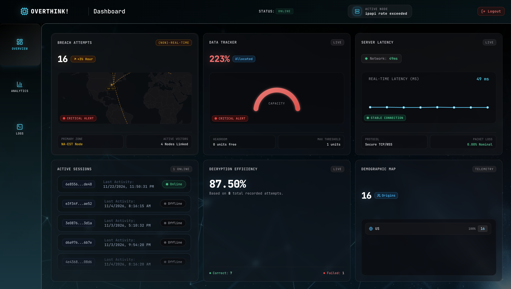
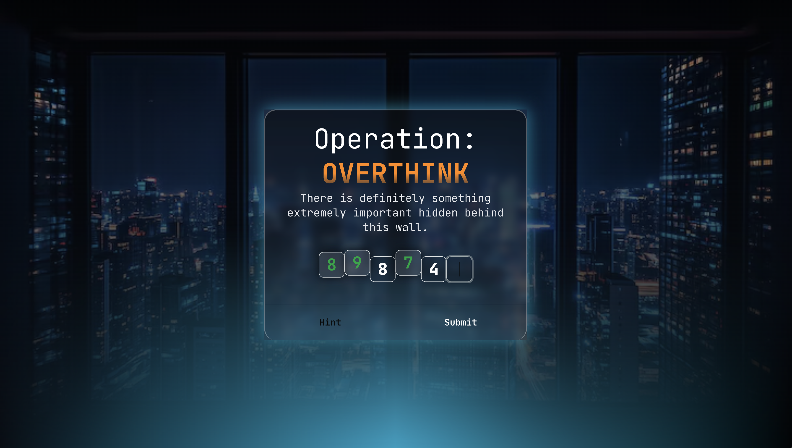
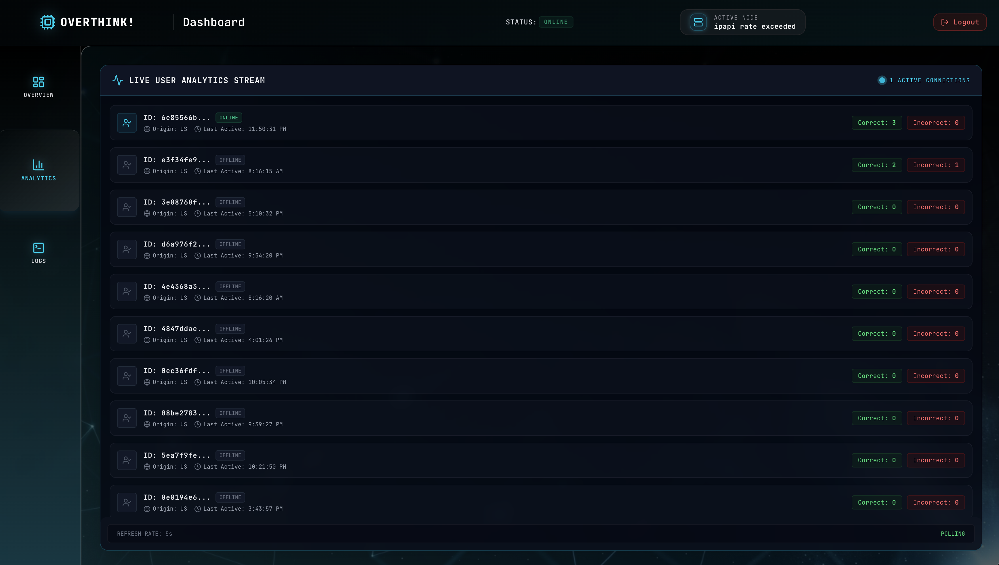
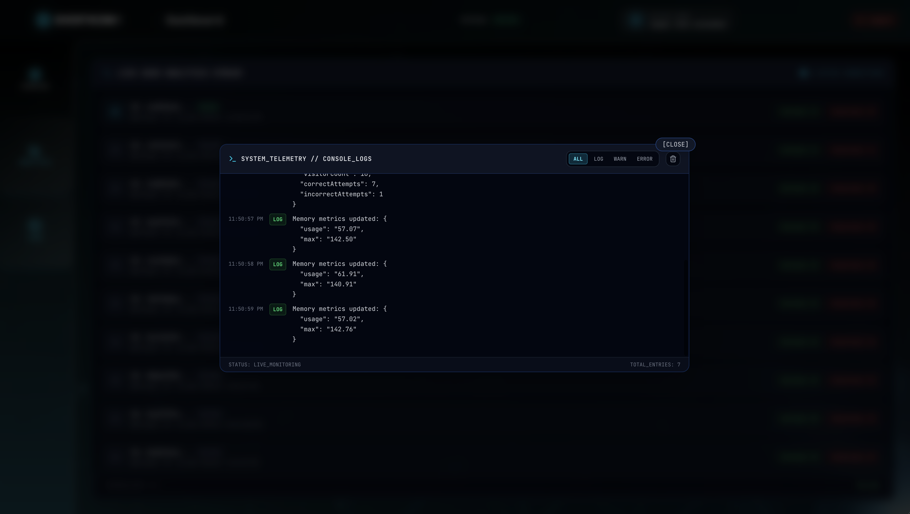
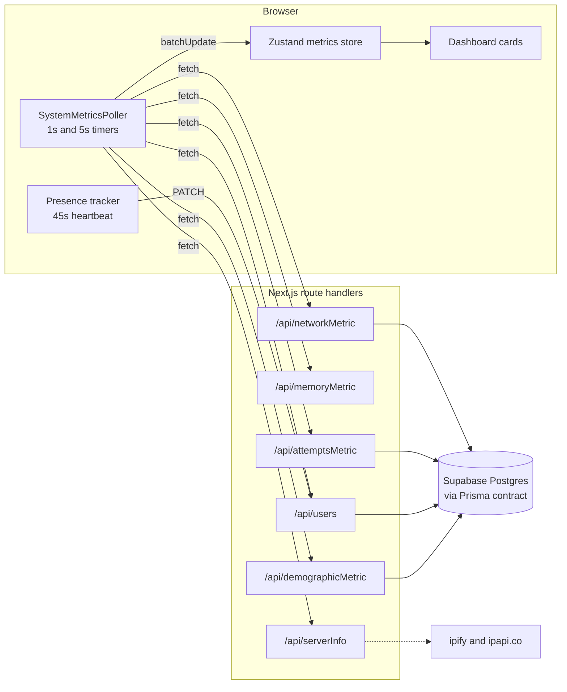
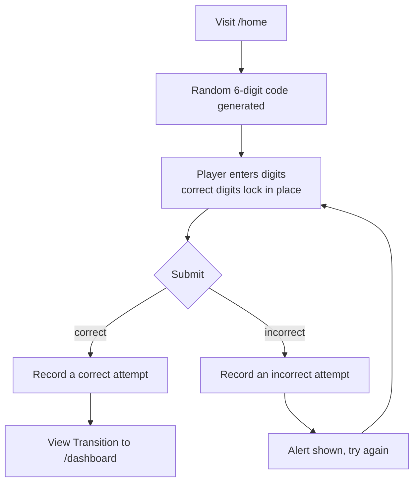

<div align="center">

# 🔐 Operation: OVERTHINK

**A code-cracking puzzle that opens into a live, database-backed telemetry dashboard.**

Crack a 6-digit combination to get in, and your attempts show up in real time on a dashboard of sessions, latency, memory, and visitor demographics, powered by Next.js route handlers, Prisma, and Supabase.

[](https://operation-overthink.netlify.app/home)




<sub>The dashboard, fed by live data from every visitor who plays</sub>

</div>

<table>
  <tr>
    <td width="33%"><br/><sub>The puzzle: correct digits lock in place</sub></td>
    <td width="33%"><br/><sub>Live user analytics stream</sub></td>
    <td width="33%"><br/><sub>In-app console that captures runtime logs</sub></td>
  </tr>
</table>

---

## Overview

Operation: OVERTHINK is a full-stack Next.js app with two halves. The first is a **puzzle**: a 6-digit lock where every correct digit snaps into place. The second is a **telemetry dashboard** that you only reach by solving it, and that reports on everyone who has played: how many visitors, who is online right now, where they are from, how many attempts succeeded, and how healthy the server and database are.

I built it to practice the full path of a real web product: a typed data layer, route handlers, client-side state, polling-based "real-time" updates, and a polished interactive UI, all deployed on serverless infrastructure.

> **What's real and what's theatre.** The spy-thriller framing is a theme. The data is real: visitor counts, online sessions, attempt totals, country breakdowns, database latency, and server memory all come from live queries. Some decoration is purely visual, such as the "breach vector" lines on the map and the "+3% Hour" badge.

## Features

| | |
|---|---|
| 🔢 **Combination puzzle** | A random 6-digit code is generated on each visit. Correct digits lock in place and cannot be deleted, so you solve it one digit at a time. A Hint button adds a twist. |
| 📊 **Live dashboard** | Six cards: breach attempts, active sessions, memory usage, decryption efficiency, server latency, and demographic breakdown |
| 🟢 **Presence tracking** | Each visitor gets an anonymous ID. A heartbeat marks them online, and anyone silent for 45 seconds drops to offline. |
| 🌍 **Visitor origins** | Country detection from edge headers with an IP geolocation fallback |
| 📡 **Real latency** | Measures an actual database round trip every second and plots the last 30 readings |
| 🖥️ **In-app console** | A terminal-style modal that captures `console.log`, `warn`, `error`, and `info` output, with filters and a clear button |
| 📈 **Analytics stream** | A live per-visitor list with correct and incorrect attempt counts and an adjustable refresh rate |
| ✨ **Polish** | WebGL shader background, motion-based animations, and a View Transitions page change into the dashboard |

## Tech Stack

| Layer | Choice | Why |
|---|---|---|
| Framework | **Next.js 16** (App Router) | File-based routing plus route handlers for the API in one codebase |
| UI | **React 19** | Component model and concurrent rendering |
| Language | **TypeScript** | End-to-end types, including database queries |
| Database | **Supabase** (PostgreSQL) | Hosted Postgres with Row Level Security and a connection pooler for serverless use |
| ORM | **Prisma ORM 8** (release candidate) | Contract-based, fully typed queries generated from a TypeScript data contract |
| State | **Zustand 5** | A single metrics store that every card reads from, with no provider boilerplate |
| Styling | **Tailwind CSS 4**, shadcn/ui, react-aria-components | Fast, consistent styling and accessible primitives |
| Charts and maps | **Recharts**, **react-simple-maps** | Rolling latency chart, radial memory gauge, and world map |
| Motion and graphics | **motion**, **OGL** | UI animation and a lightweight WebGL background shader |
| Input | **input-otp** | Accessible segmented code entry |
| Tooling | **pnpm** | |
| Hosting | **Netlify** | |

## Architecture

The browser polls a set of route handlers on two timers, merges the results into one Zustand store, and each dashboard card subscribes to only the slice it displays.



### The player flow



### Polling cadence

| Timer | Endpoints | Why |
|---|---|---|
| **1 second** | `networkMetric`, `memoryMetric` | Fast-moving values: latency and memory |
| **5 seconds** | `attemptsMetric`, `users` (active list), `demographicMetric` | Aggregates that change when a person acts |
| **Once, on mount** | all of the above, plus visitor registration and `serverInfo` | Fill the dashboard immediately |

### Data model

One table, defined in code in [`src/prisma/contract.ts`](src/prisma/contract.ts):

| Field | Type | Default | Purpose |
|---|---|---|---|
| `id` | UUID string | generated | Anonymous visitor ID (also stored in the visitor's browser) |
| `countryOfOrigin` | text | `"NaN"` | Detected country |
| `correctAttempts` | int | `0` | Successful solves |
| `incorrectAttempts` | int | `0` | Failed attempts |
| `isActive` | boolean | `false` | Last reported presence |
| `role` | text | `"USER"` | Reserved for future role-based features |
| `createdAt`, `updatedAt`, `lastOnline` | text (ISO timestamp) | `now()` | Lifecycle and presence |

Row Level Security is enabled on the table, with a named policy for each operation (select, insert, update) across the `anon`, `authenticated`, and `supabase_admin` roles.

### API routes

| Route | Method | Purpose |
|---|---|---|
| `/api/users` | `GET` | Active visitor list (`?returnType=getActiveUsers`) or total count (`?returnType=userCount`) |
| `/api/users` | `POST` | Register a visitor, upsert their record, and detect their country |
| `/api/users` | `PATCH` | Presence heartbeat: update `isActive` and `lastOnline` |
| `/api/attemptsMetric` | `GET` | Total correct and incorrect attempts across all visitors |
| `/api/attemptsMetric` | `POST` | Record one correct or incorrect attempt for a visitor |
| `/api/demographicMetric` | `GET` | Visitor counts grouped by country |
| `/api/networkMetric` | `GET` | Time of a real database round trip, in milliseconds |
| `/api/memoryMetric` | `GET` | Server heap usage and resident memory, in MB |
| `/api/serverInfo` | `GET` | Server location lookup, cached in memory with graceful fallbacks |

## Engineering Highlights

### 🧱 A typed data contract

The database layer uses Prisma ORM 8's contract-based API. The `User` model, the Row Level Security setting, and the access policies are all declared in TypeScript in one file. `prisma contract emit` compiles it to `contract.json` and `contract.d.ts`, and `prebuild` runs it automatically so a deploy never ships stale types. Queries such as `db.orm.public.User.where(...).upsert(...)` and `groupBy(...).aggregate(...)` are checked at compile time.

### ⚡ Near-real-time without WebSockets

A single `SystemMetricsPoller` runs two timers and merges whatever comes back into the store with one `batchUpdate` call. Requests share an `AbortController`, so unmounting cancels anything still in flight and clears both intervals. Each card selects only the fields it needs from the store, so a latency tick does not re-render the whole dashboard.

### 🟢 Honest presence tracking

"Online" is never taken on trust. The client sends a heartbeat every 45 seconds and also reports when the tab is hidden or shown. On the server, a visitor only counts as online if they are flagged active **and** were last seen within the past 45 seconds, so closed tabs and dropped connections age out on their own.

### 🌍 Layered geolocation

Country detection tries the hosting platform's edge header first (free and instant), then falls back to an IP lookup, and finally to a default, so a failure of one source never breaks sign-in. The server's own location is looked up once and cached.

### 🖥️ A console inside the app

The Logs view wraps `console.log`, `warn`, `error`, and `info`, and also listens for uncaught errors and unhandled promise rejections, then renders everything in a filterable terminal-style panel capped at roughly the latest 100 entries. The original console methods are restored on cleanup, so it never leaks into the rest of the app.

### 🧩 Config-driven dashboard

Cards are registered in one list (`dashboardCards.tsx`) with an id, a title, and a component. The layout maps over that list, so adding a card means writing the component and adding one entry.

### 🎮 Puzzle interaction details

Correct digits lock and cannot be erased, so backspace only removes unlocked digits. Newly locked digits animate, and a correct answer navigates with the browser's View Transitions API where available (with a plain navigation fallback). The background is a WebGL shader rendered with OGL.

## 🐛 Engineering Challenges

Two problems that took real debugging time, and how I solved them.

### 1. Map lines drifting off the landmass

**Problem:** I used `react-simple-maps` with custom `[longitude, latitude]` pairs for the threat lines. When the layout scaled responsively, the lines rendered detached from the map locations they were meant to connect.

**Fix:** I pinned the projection down: `geoNaturalEarth1` with an explicit scale and center (`[-50, 20]`), a fixed 400 x 200 coordinate space, and the node markers placed in an absolutely positioned layer over the map. The lines are dashed strokes drawn in the same coordinate space, so everything scales together across breakpoints.

### 2. Schema drift between the database and the TypeScript types

**Problem:** While I was iterating against a live Supabase PostgreSQL instance, the TypeScript contract and the real database schema fell out of sync. The result was silent serialization failures and runtime query exceptions in the aggregate data mapping.

**Fix:** I audited both sides and reconciled the Prisma definitions with the Supabase migrations. I also tightened the types on API responses and fixed mismatches between the client store's models and what the route handlers return. The data contract is now the single source of truth, and `prebuild` regenerates it before every build.

**Takeaway:** Both were boundary problems: one between a library's coordinate system and CSS, the other between a database and its types.

## Getting Started

### Prerequisites

- **Node.js 24+** and **pnpm** (the project notes target pnpm 11)
- A **Supabase** project (the free tier works)

### Install and run

```bash
# 1. Clone the repo
git clone https://github.com/krsnelgrove-del/operation-overthink.git
cd operation-overthink

# 2. Install dependencies
pnpm install

# 3. Add your environment variables (see below)

# 4. Generate the typed contract, then create the table in your database
pnpm prisma contract emit
pnpm prisma db init

# 5. Start the dev server
pnpm dev
```

Open [http://localhost:3000/home](http://localhost:3000/home).

### Environment variables

Create a `.env` file in the project root with the two connection strings from your Supabase project's database settings:

```env
# Pooled connection string (used by the Prisma CLI configuration)
DATABASE_URL="postgresql://<user>:<password>@<pooler-host>:6543/postgres"

# Direct connection string (used by the runtime database client)
DIRECT_URL="postgresql://<user>:<password>@<host>:5432/postgres"
```

> Never commit your `.env` file. It is listed here by name only.

Locally, visitor country defaults to `US` because there is no edge header or public IP to read.

### Scripts

| Command | What it does |
|---|---|
| `pnpm dev` | Start the development server |
| `pnpm build` | Production build (regenerates the data contract first) |
| `pnpm start` | Serve the production build |
| `pnpm contract:emit` | Regenerate `contract.json` and `contract.d.ts` |

## Project Structure

```
src/
├── app/
│   ├── home/page.tsx              # The puzzle
│   ├── dashboard/                 # Dashboard page, layout, and card registry
│   ├── api/
│   │   ├── users/                 # Visitors, presence, active list
│   │   ├── attemptsMetric/        # Correct and incorrect attempt totals
│   │   ├── demographicMetric/     # Country breakdown
│   │   ├── networkMetric/         # Database round-trip latency
│   │   ├── memoryMetric/          # Server memory
│   │   └── serverInfo/            # Server location lookup
│   └── (utils)/
│       ├── systemMetricsPoller.tsx  # Tiered polling orchestrator
│       └── useMetricsStore.tsx      # Zustand metrics store
├── components/
│   ├── cards/                     # Dashboard cards and the combination lock
│   ├── dashboard/                 # Header, navigation, content area
│   ├── modals/                    # Analytics stream and console modals
│   ├── logs/                      # Terminal log renderer
│   ├── animations/                # WebGL background (OGL)
│   └── ui/                        # shadcn-style primitives
├── hooks/
│   ├── usePresenceTracker.ts      # Heartbeat and visibility tracking
│   └── useConsoleLogs.ts          # Console capture
└── prisma/
    ├── contract.ts                # Data contract: model, RLS, policies
    └── db.ts                      # Typed database client
```

## Roadmap

Known gaps and next steps:

- [ ] The secret code is intentionally shown to the browser in the hint popup; as a joke.
- [ ] Replace polling with **Supabase Realtime** or Server-Sent Events
- [ ] Tighten the **Row Level Security** policies (they are currently open, because visitors are anonymous by design)
- [ ] Store timestamps as native `timestamptz` columns instead of text
- [ ] Add automated tests for the route handlers

## Credits

- World map data from [world-atlas](https://github.com/topojson/world-atlas), served by jsDelivr
- Server and visitor location lookups via [ipify](https://www.ipify.org/) and [ipapi.co](https://ipapi.co/)

## Author

**Kyle Snelgrove**, full-stack software engineer.

[](https://www.linkedin.com/in/kyle-snelgrove/)
[](https://github.com/krsnelgrove-del)

If you've read this far, thanks for taking a look. Feedback and questions are welcome.
